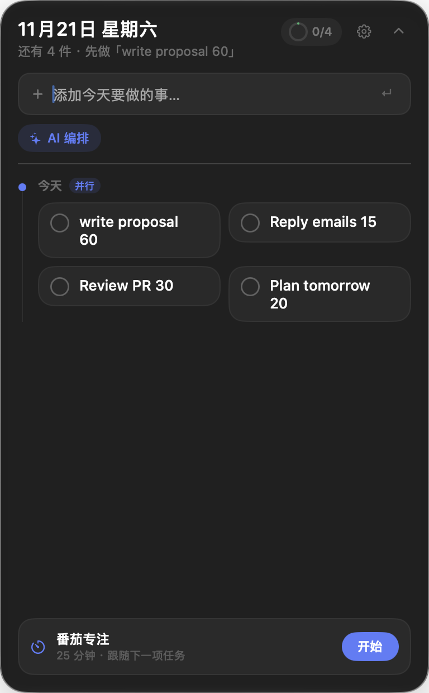
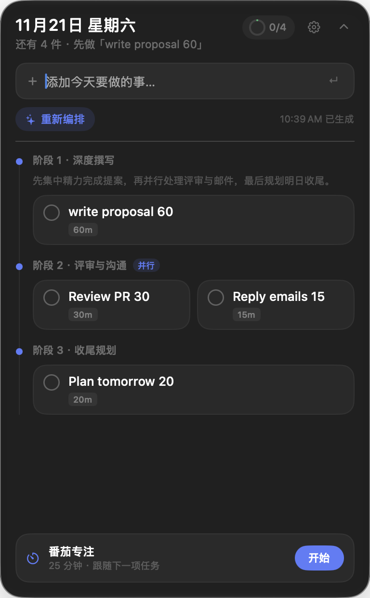
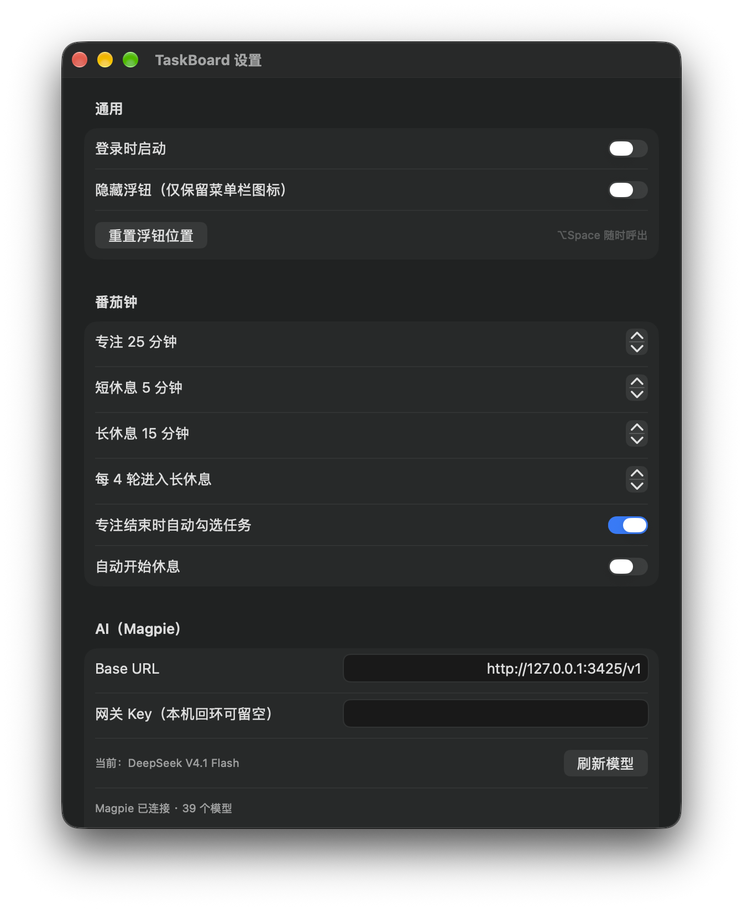

# TaskBoard

一个常驻 macOS 桌面的今日任务看板：右上角玻璃浮钮点开面板，AI 编排今天的阶段与并行任务，内置番茄钟、专注悬浮条、任务归档与备份。

> 纯本地数据，无账号、无遥测。AI 能力可选接入任意 OpenAI 兼容网关（默认配合本机 Magpie 使用）。



## 功能

- **浮钮 + 面板**：`NSPanel` 非激活浮窗，不抢前台焦点、不进 Dock、默认不参与截屏/录屏（可临时开启）。
- **AI 编排 / 细化**：按任务轻重缓急与并行关系排出阶段；编排前可填写指导意见；单个任务可按描述拆出二级任务。
- **任务卡片**：状态（待办 / 进行中 / 阻塞 / 等待）与阻塞原因、描述、标题编辑、状态说明、进度条（真实 / 对外两套）、拖动排序与跨阶段移动。
- **番茄钟**：可配置专注/休息时长，专注中显示顶部悬浮条，菜单栏图标显示倒计时。
- **归档**：完成后按天自动归档；独立归档窗口支持搜索、还原、导出 / 导入 JSON 备份；可设置保留天数并自动清理（清理前自动备份，保留最近 20 份）。
- **更新检查**：菜单栏或设置页「检查更新」读取 GitHub Releases 最新版本，一键跳转下载页。

| AI 编排 | 设置 |
| --- | --- |
|  |  |

## 系统要求

- macOS 26.0+
- Xcode 27+（Swift 6）
- [XcodeGen](https://github.com/yonaskolb/XcodeGen)（工程文件由 `project.yml` 生成）

## 构建与运行

```bash
brew install xcodegen
xcodegen generate
xcodebuild -project TaskBoard.xcodeproj -scheme TaskBoard -configuration Debug \
  -derivedDataPath build CODE_SIGN_IDENTITY="-" build
open build/Build/Products/Debug/TaskBoard.app
```

运行测试：

```bash
xcodebuild -project TaskBoard.xcodeproj -scheme TaskBoard \
  -destination 'platform=macOS' -derivedDataPath build test CODE_SIGN_IDENTITY="-"
```

> 测试默认使用内存数据库；直接运行 App 会读写
> `~/Library/Application Support/default.store`，请勿在真实数据上做破坏性自动化。

## 使用说明

- 点击浮钮或按 `⌥Space` 打开/收起面板；浮钮可拖动，位置会记忆。
- 右键浮钮或菜单栏图标可以打开归档、设置、切换截图模式、检查更新。
- 归档默认保留在 `~/Library/Application Support/TaskBoard/Backups/`（自动备份 JSON，文件名精确到秒）。
- 应用为自用定位，使用 ad-hoc 签名，未做公证：首次打开如被 Gatekeeper 拦截，请右键「打开」，或执行
  `xattr -dr com.apple.quarantine /Applications/TaskBoard.app`。

## AI 配置

设置 → AI 可选两种来源：

1. **Magpie 插件**：读取 `~/Library/Application Support/TaskBoard/agent.json`（由 Magpie 写入 `ai.baseURL` / `ai.apiKey` / `ai.modelID`）。
2. **手动配置**：自行填写 Base URL 与 API Key，并从 `/v1/models` 拉取模型列表。

应用只向所配置的网关发起 `chat/completions` 与 `models` 请求；检查更新时仅访问 GitHub Releases API。

## 发布与更新链路

- 推送 `v*` 标签会触发 [Release workflow](.github/workflows/release.yml)：按标签号写入 App 版本、构建 Release、打包 zip + SHA256，并发布到 GitHub Releases。
- 应用内「检查更新」请求 `releases/latest`，比较版本号后给出下载入口。
- 发布新版本：

  ```bash
  git tag v0.2.0
  git push origin v0.2.0
  ```

  工作流完成后，老版本即可在应用内检测到更新。

## 数据与隐私

- 任务、番茄钟记录保存在本机 SwiftData 数据库中；设置保存在 `UserDefaults`。
- 不包含埋点、崩溃上报或账号体系。
- 若填写了 AI API Key，它会以明文保存在本机 `UserDefaults`，请自行评估风险。

## 许可证

[MIT](LICENSE)
